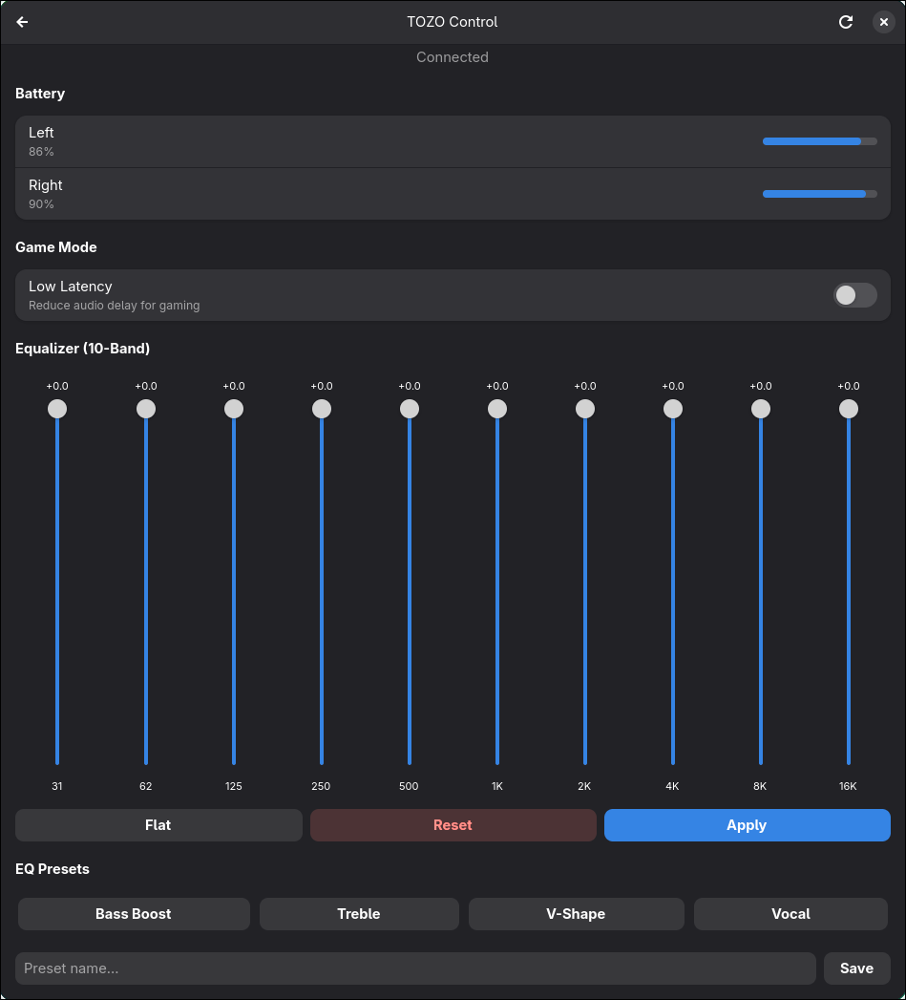

# TOZO Control

## Omarchy HT3 plugin

This checkout also includes a native Omarchy Shell / Quickshell top-bar plugin
for TOZO HT3 headphones: volume, hardware EQ, ANC and transparency.
See [the plugin guide](omarchy-ht3/README.md) for usage and protocol evidence.

```bash
mise run test
mise run install
```

The plugin uses Python's standard library and Bluetooth Classic RFCOMM; the
GTK/Bleak setup below is for the original standalone application only.

A Linux GTK4 app to control TOZO earbuds via BLE — no Android app needed.

Um app GTK4 para Linux para controlar fones TOZO via BLE — sem precisar do app Android.




---

## Help this project grow / Ajude o projeto a crescer

This project was built by reverse-engineering the TOZO Android app's BLE protocol. To support more earbuds models and other brands, we need physical devices to test with.

If you'd like to help, consider donating a pair of TOZO earbuds (or other BLE earbuds) so we can map their protocol and add support. The goal is to build a **universal Linux earbuds control app** — starting with TOZO and expanding to other brands over time.

**Got a pair of BLE earbuds that only work with a phone app? Open an issue!** We'll work together to reverse-engineer the protocol and add support.

---

Este projeto foi criado através de engenharia reversa do protocolo BLE do app Android da TOZO. Para dar suporte a mais modelos de fones e outras marcas, precisamos de dispositivos físicos para testar.

Se quiser ajudar, considere doar um par de fones TOZO (ou outros fones BLE) para que possamos mapear o protocolo e adicionar suporte. O objetivo é construir um **app universal de controle de fones no Linux** — começando pela TOZO e expandindo para outras marcas.

**Tem um fone BLE que só funciona com app de celular? Abra uma issue!** Vamos trabalhar juntos para fazer engenharia reversa do protocolo e adicionar suporte.

---

## Features / Funcionalidades

- **Battery / Bateria** — real-time left/right earbud battery levels / nível de bateria em tempo real de cada lado
- **Game Mode / Modo Jogo** — toggle low-latency mode / ativar/desativar modo de baixa latência
- **10-Band EQ / Equalizador 10 Bandas** — full equalizer with visual sliders (31Hz–16KHz) / equalizador completo com sliders visuais
- **EQ Presets** — built-in presets (Bass Boost, Treble, V-Shape, Vocal) + save your own / presets prontos + salve os seus
- **Device Picker / Seletor de Dispositivo** — scan for BLE devices or connect from paired list / escaneie ou conecte da lista de pareados
- **Auto-reconnect / Auto-reconexão** — remembers last connected device / lembra o último dispositivo conectado

## Tested Models / Modelos Testados

| Model / Modelo | Status |
|-------|--------|
| TOZO T10 | Fully working / Funcionando 100% |

Other TOZO models using the same BLE protocol (service `B610`/`FAA0`) should work too.

Outros modelos TOZO usando o mesmo protocolo BLE (serviço `B610`/`FAA0`) devem funcionar também.

## How It Works / Como Funciona

The app communicates directly with TOZO earbuds over BLE GATT using a protocol reverse-engineered from the official TOZO Android app. It writes commands to characteristic `B611` and receives responses via notifications on `B612`.

O app se comunica diretamente com os fones TOZO via BLE GATT usando um protocolo obtido por engenharia reversa do app Android oficial. Envia comandos pela característica `B611` e recebe respostas via notificações na `B612`.

**Protocol format / Formato do protocolo:**
```
GET: [0x00, param_id, 0x00, 0x00]
SET: [0x10, param_id, payload_len, payload..., checksum]
     checksum = sum(payload_bytes) & 0xFF
```

## Dependencies / Dependências

### Arch / CachyOS / Manjaro

```bash
sudo pacman -S gtk4 libadwaita python-gobject bluez
```

### Debian / Ubuntu / Pop!_OS

```bash
sudo apt install python3-gi gir1.2-gtk-4.0 gir1.2-adw-1 bluez
```

### Fedora

```bash
sudo dnf install gtk4 libadwaita python3-gobject bluez
```

### Python

```bash
pip install bleak
```

## Install & Run / Instalar e Rodar

```bash
git clone https://github.com/GabriWar/tozo-control.git
cd tozo-control
pip install -r requirements.txt
python3 tozo_control.py
```

## Usage / Como Usar

1. **Pair your earbuds / Pareie seus fones** via Bluetooth settings ou `bluetoothctl`:
   ```bash
   bluetoothctl scan on
   bluetoothctl pair XX:XX:XX:XX:XX:XX
   bluetoothctl trust XX:XX:XX:XX:XX:XX
   ```

2. **Launch / Abra o app**: `python3 tozo_control.py`

3. **Connect / Conecte**: click your earbuds in "Paired Devices" or scan / clique nos fones em "Pareados" ou escaneie

4. **Control / Controle**:
   - Toggle Game Mode with the switch / Ative o Modo Jogo com o switch
   - Adjust EQ sliders and click **Apply** / Ajuste os sliders do EQ e clique **Aplicar**
   - Save custom EQ presets / Salve presets de EQ personalizados
   - Click **Flat** to reset to 0 dB / Clique **Flat** para resetar para 0 dB

## EQ Range / Faixa do EQ

The hardware EQ range is 0–50 per band / A faixa do EQ do hardware é 0–50 por banda:
- **50** = 0.0 dB (flat / sem alteração)
- **0** = -5.0 dB (maximum cut / corte máximo)

## Config / Configuração

Settings and presets are saved to / Configurações e presets salvos em `~/.config/tozo-control/`:
- `settings.json` — last connected device / último dispositivo conectado
- `presets.json` — saved EQ presets / presets de EQ salvos

## Protocol Reference / Referência do Protocolo

Full command list discovered from APK reverse engineering:

Lista completa de comandos descobertos via engenharia reversa do APK:

| Param ID | GET (0x00) | SET (0x10) | Description / Descrição |
|----------|------------|------------|-------------|
| 0x01 | FW Version | — | Firmware version / Versão do firmware |
| 0x02 | Battery | — | L/R battery % / Bateria E/D % |
| 0x03 | Button Config | Button Config | Touch actions / Ações de toque |
| 0x04 | ANC On/Off | ANC On/Off | Active Noise Cancellation / Cancelamento de ruído ativo |
| 0x05 | Transparency | Transparency | Hear-through mode / Modo transparência |
| 0x06 | Game Mode | Game Mode | Low latency toggle / Baixa latência |
| 0x07 | Wind Noise | Wind Noise | Wind noise reduction / Redução de ruído de vento |
| 0x0B | EQ 10-Band | EQ 10-Band | 10-band equalizer / Equalizador 10 bandas |
| 0x0C | — | EQ Reset | Reset EQ to default / Resetar EQ |
| 0x10 | — | Power Off | Turn off earbuds / Desligar fones |
| 0x16 | Wear Detection | Wear Detection | Auto-pause on removal / Auto-pausa ao remover |
| 0x25 | Multipoint | Multipoint | 1-to-2 connection / Conexão 1-para-2 |
| 0x26 | L/R Balance | L/R Balance | Left/right volume balance / Balanço de volume E/D |
| 0x28 | Volume | Volume | Playback volume / Volume de reprodução |
| 0x29 | LDAC | LDAC | Hi-res codec toggle / Codec de alta resolução |
| 0x30 | ANC Mode | ANC Mode | ANC mode selection / Seleção de modo ANC |

> Not all commands are supported by all models. The T10 supports: Battery, Game Mode, EQ, L/R Balance, Connection Status.
>
> Nem todos os comandos são suportados por todos os modelos. O T10 suporta: Bateria, Modo Jogo, EQ, Balanço E/D, Status de Conexão.

## BLE Details / Detalhes BLE

- TOZO earbuds use **dual-mode Bluetooth** — Classic BT for audio (A2DP/HFP) and BLE for control / Fones TOZO usam **Bluetooth dual-mode** — BT Clássico para áudio e BLE para controle
- The **BLE MAC address differs** from the Classic BT MAC (typically first byte changes) / O **endereço MAC BLE é diferente** do MAC BT Clássico (geralmente o primeiro byte muda)
- GATT Service: `0000b610` (or `0000faa0` on older models / ou `0000faa0` em modelos antigos)
- Write Characteristic: `0000b611` (write-without-response)
- Notify Characteristic: `0000b612` (notifications / notificações)

## Roadmap

- [ ] Support more TOZO models / Suporte a mais modelos TOZO
- [ ] Add ANC/Transparency controls for supported models / Controles de ANC/Transparência para modelos compatíveis
- [ ] Button remapping UI / Interface de remapeamento de botões
- [ ] Support other BLE earbuds brands / Suporte a outras marcas de fones BLE
- [ ] Flatpak packaging / Empacotamento Flatpak
- [ ] Snap packaging / Empacotamento Snap
- [ ] Standalone compiled binary / Binário compilado standalone
- [ ] AUR package
- [ ] Systray with battery indicator / Bandeja do sistema com indicador de bateria

## Contributing / Contribuindo

Contributions are welcome! If you have TOZO earbuds (or other BLE earbuds) and want to help:

Contribuições são bem-vindas! Se você tem fones TOZO (ou outros fones BLE) e quer ajudar:

1. Open an issue with your earbud model / Abra uma issue com o modelo do seu fone
2. Run `tozo_control.py` and share the GATT services output / Rode o app e compartilhe a saída dos serviços GATT
3. Help test new commands / Ajude a testar novos comandos

## License / Licença

MIT
