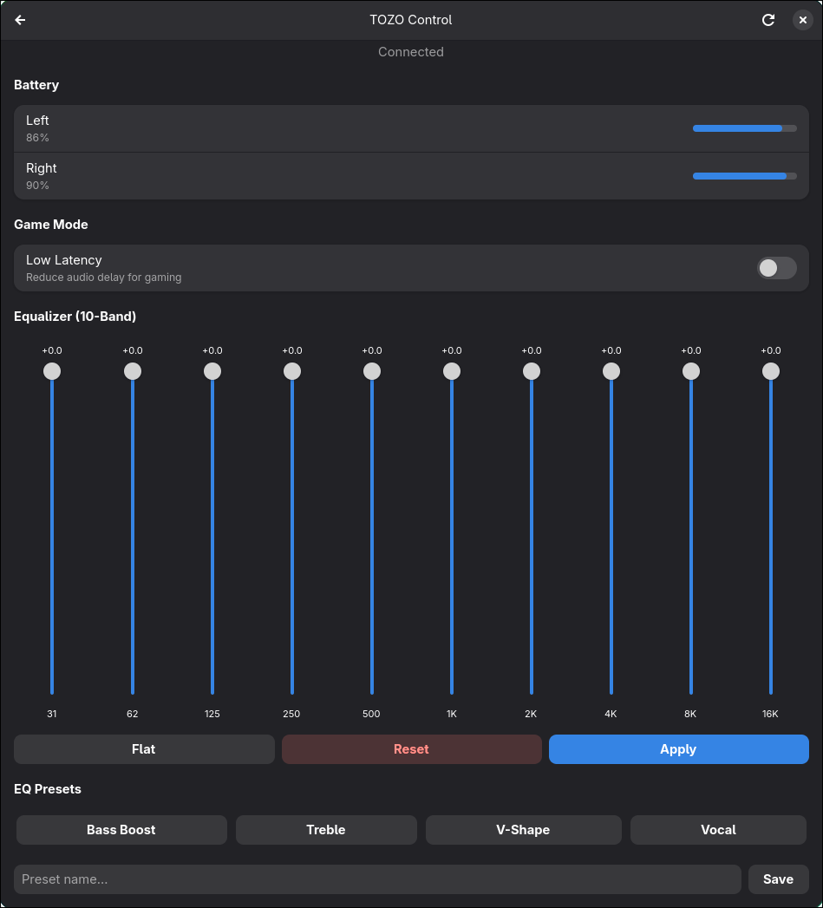

# TOZO Control

A Linux GTK4 app that controls TOZO earbuds over Bluetooth Low Energy, so you do not need the TOZO phone app for battery, game mode and EQ. It was written by [GabriWar](https://github.com/GabriWar/tozo-control) by reverse-engineering the BLE protocol of the TOZO Android app; this repository is a copy that also carries an [Omarchy](https://github.com/basecamp/omarchy) top-bar plugin for TOZO HT3 headphones.

Both parts are small hobby tools. The GTK app has been tested only with the TOZO T10, and the Omarchy plugin only with one TOZO HT3.



## Features

### GTK app (`tozo_control.py`)

- Left and right battery levels.
- Game mode (low latency) on or off.
- Ten-band EQ from 31 Hz to 16 kHz with sliders, **Apply** and **Flat**.
- Built-in EQ presets (Bass Boost, Treble, V-Shape, Vocal), plus your own saved presets.
- BLE scan or connect from the list of paired devices.
- Remembers the last connected device and reconnects to it.

Other TOZO models that use the same BLE service (`B610`, or `FAA0` on older models) may work but have not been tested.

### Omarchy HT3 plugin (`omarchy-ht3/`)

A Quickshell top-bar widget for TOZO HT3 headphones with playback volume and mute through PipeWire, normal, ANC and transparency modes, the ten-band hardware EQ (-5 to +5 dB) and battery status. It talks to the headset over Bluetooth Classic RFCOMM using only the Python standard library. See [omarchy-ht3/README.md](omarchy-ht3/README.md) for usage and [omarchy-ht3/PROTOCOL.md](omarchy-ht3/PROTOCOL.md) for the protocol notes. The same plugin is also published on its own as [omarchy-plugin-ht3](https://github.com/subculture-collective/omarchy-plugin-ht3).

## Quick start: GTK app

Install the system packages for your distribution:

```bash
# Arch, CachyOS, Manjaro
sudo pacman -S gtk4 libadwaita python-gobject bluez

# Debian, Ubuntu, Pop!_OS
sudo apt install python3-gi gir1.2-gtk-4.0 gir1.2-adw-1 bluez

# Fedora
sudo dnf install gtk4 libadwaita python3-gobject bluez
```

Then install [Bleak](https://github.com/hbldh/bleak) and run the app (Python 3.10 or later):

```bash
git clone https://github.com/subculture-collective/tozo-control.git
cd tozo-control
pip install -r requirements.txt
python3 tozo_control.py
```

1. Pair the earbuds in your Bluetooth settings, or with `bluetoothctl`:

   ```bash
   bluetoothctl scan on
   bluetoothctl pair XX:XX:XX:XX:XX:XX
   bluetoothctl trust XX:XX:XX:XX:XX:XX
   ```

2. Start the app with `python3 tozo_control.py`.
3. Select the earbuds under paired devices, or scan.
4. Use the game mode switch, move the EQ sliders and select **Apply**, save presets, or select **Flat** to reset every band to 0 dB.

## Quick start: Omarchy plugin

Requirements: Omarchy 4 with Quickshell, BlueZ, PipeWire, `/usr/bin/python3` and [mise](https://mise.jdx.dev). Pair the HT3 first.

```bash
mise run test      # helper tests, plugin validation and QML lint
mise run install   # copy the plugin into Omarchy and enable it
```

`mise run install` runs `install-plugin.py`. It copies `omarchy-ht3/` to `~/.config/omarchy/plugins/patrickfanella.ht3`, backs up any existing copy and `shell.json` under `~/.local/state/omarchy-ht3/backups/`, enables the widget on the right of the bar and restarts the Omarchy shell. The installed plugin is a copy, so run the install again after you change the source.

## Configuration

The GTK app keeps its files in `~/.config/tozo-control/`:

- `settings.json`: the last connected device.
- `presets.json`: your saved EQ presets.

The Omarchy plugin has no settings file.

## How the GTK app talks to the earbuds

TOZO earbuds use dual-mode Bluetooth: Classic Bluetooth for audio (A2DP, HFP) and BLE for control. The BLE MAC address differs from the Classic one, usually in the first byte.

- GATT service: `0000b610` (`0000faa0` on older models).
- Write characteristic: `0000b611` (write without response).
- Notify characteristic: `0000b612`.

Commands:

```text
GET: [0x00, param_id, 0x00, 0x00]
SET: [0x10, param_id, payload_len, payload..., checksum]
     checksum = sum(payload_bytes) & 0xFF
```

The hardware EQ uses 0 to 50 per band: 50 is 0.0 dB and 0 is -5.0 dB.

Parameter IDs found in the Android app:

| ID | GET (0x00) | SET (0x10) | Meaning |
| --- | --- | --- | --- |
| 0x01 | Firmware version | | Firmware version |
| 0x02 | Battery | | Left and right battery % |
| 0x03 | Button config | Button config | Touch actions |
| 0x04 | ANC on/off | ANC on/off | Active noise cancellation |
| 0x05 | Transparency | Transparency | Hear-through mode |
| 0x06 | Game mode | Game mode | Low latency |
| 0x07 | Wind noise | Wind noise | Wind noise reduction |
| 0x0B | EQ 10-band | EQ 10-band | Ten-band equalizer |
| 0x0C | | EQ reset | Reset EQ to default |
| 0x10 | | Power off | Turn the earbuds off |
| 0x16 | Wear detection | Wear detection | Pause when removed |
| 0x25 | Multipoint | Multipoint | Connect to two devices |
| 0x26 | L/R balance | L/R balance | Left and right volume balance |
| 0x28 | Volume | Volume | Playback volume |
| 0x29 | LDAC | LDAC | Hi-res codec |
| 0x30 | ANC mode | ANC mode | ANC mode selection |

Not every model supports every command. The T10 supports battery, game mode, EQ, L/R balance and connection status. The HT3 plugin uses a different transport and EQ encoding; see its protocol notes.

## Project layout

| Path | Contents |
| --- | --- |
| `tozo_control.py` | The GTK4 app. |
| `requirements.txt` | Python dependency for the GTK app (`bleak`). |
| `omarchy-ht3/` | The Omarchy HT3 plugin: `Widget.qml`, `bridge.py`, `manifest.json` and its docs. |
| `install-plugin.py` | Installs the plugin into Omarchy. |
| `tests/test_ht3.py` | Tests for the HT3 helper. |
| `mise.toml` | `test` and `install` tasks. |

## Contributing

Report bugs and request features in [GitHub issues](https://github.com/subculture-collective/tozo-control/issues). If you have a TOZO model that is not listed, an issue with the model name and the app's log (it prints to the terminal and appends to `/tmp/tozo_control.log`) helps. Send code as pull requests on GitHub against `main`. CI runs the HT3 helper tests on every pull request.

## License

[MIT](LICENSE). Copyright (c) 2025 GabriWar.
